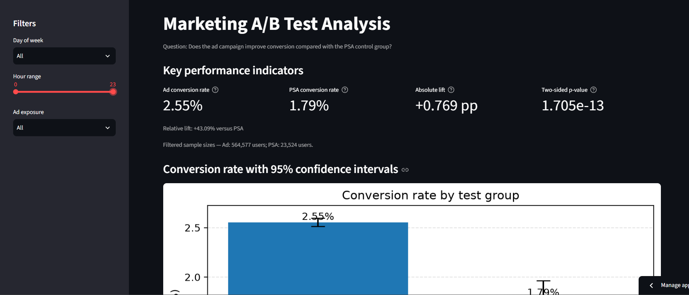

# Marketing A/B Test Analysis

**Business question:** Does the ad campaign increase conversion compared with the public service announcement (PSA) control group?

**Live app:** [View the A/B Test Analysis Dashboard](https://ab-test-analysis-njlhonfbjklkgnbppe3dzw.streamlit.app/)



## Key Findings

| Metric | Ad group | PSA group |
| --- | ---: | ---: |
| Users | 564,577 | 23,524 |
| Conversions | 14,423 | 420 |
| Conversion rate | 2.555% | 1.785% |
| 95% CI (Wilson) | 2.514% – 2.596% | 1.624% – 1.963% |

* **Absolute lift:** +0.769 percentage points (95% CI for the difference: 0.587 to 0.936 pp, Newcombe method).
* **Relative lift:** +43.09% versus PSA.
* **Two-proportion z-test:** z = 7.37, p = 1.7 × 10⁻¹³. A chi-square test gives the same p-value.
* **Effect size:** Cohen's h = 0.053 (a small effect), so the result is statistically clear but modest in size.
* **Decision:** Reject H0 at the 5% level. The ad group converted better than the PSA group in this dataset.

### Segment results (exploratory)

22 segment-level tests were run (weekday/weekend, each hour of the day, low/high ad exposure), so a Bonferroni-adjusted threshold of 0.05 / 22 ≈ 0.0023 was used (segments with zero conversions in either group were skipped).

| Segment | Lift (pp) | Significant after correction? |
| --- | ---: | :---: |
| Weekday | +0.856 | Yes |
| Weekend | +0.559 | No (p = 0.0047) |
| High exposure | +1.427 | Yes |
| Low exposure | -0.029 | No (p = 0.61) |
| Hour 14 | +1.252 | Yes (only 30 PSA conversions, treat with caution) |

## Method

1. **Data checks:** removed the exported index column, checked missing values and duplicates (none found), and standardized column names.
2. **Sample check:** the allocation is highly imbalanced (about 96% ad / 4% PSA), so confidence intervals and power were examined.
3. **SQL analysis:** the data is loaded into SQLite and analysed with 5 queries in `sql/queries.sql` (group metrics, conversion by day, exposure buckets with `CASE WHEN`, hourly metrics with a CTE, and day ranking with `RANK()`).
4. **Hypothesis test:** two-sided two-proportion z-test, confidence intervals, chi-square check, and a power calculation.
5. **Segments and business impact:** Bonferroni-corrected segment tests and an illustrative ROI scenario.

## Illustrative ROI (assumptions, not real business data)

Assuming ₹500 value per conversion and a ₹1,00,000 campaign cost for the same 564,577 targeted users, the observed lift implies about 4,343 extra conversions and an ROI of about 2,071%. These inputs are placeholders for demonstration only; the real decision needs actual campaign cost and profit per conversion.

## Limitations

* Conversion is measured, not profit.
* Ad exposure was not randomized, so differences between low- and high-exposure users are associations, not causal effects.
* The 96/4 allocation is unusual, and the original design is unknown, so the PSA estimate is less precise.
* Segment results are exploratory, even after correction.

## Project Structure

```text
ab-test-analysis/
├── app.py                  # Streamlit dashboard
├── data/
│   └── marketing_AB.csv
├── notebooks/
│   └── analysis.ipynb
├── sql/
│   └── queries.sql
├── screenshots/
│   └── dashboard.png
├── requirements.txt
└── README.md
```

## How to Run

```bash
git clone https://github.com/priya-39/ab-test-analysis.git
cd ab-test-analysis
pip install -r requirements.txt
streamlit run app.py
```

Open `notebooks/analysis.ipynb` in Jupyter to see the full analysis.

## Tools

Python, Pandas, NumPy, SciPy, Statsmodels, Matplotlib, Seaborn, SQL (SQLite), Streamlit.
